<div align="center">


# DeVito Styles

**A full-stack barbershop platform for booking appointments, shopping grooming products and managing the shop.**


</div>

## Overview

DeVito Styles is a full-stack web application for a modern barbershop. Customers can create an account, browse services, book a time with their preferred barber, review past visits and buy grooming products through Stripe checkout. Admins get a dashboard to oversee users, appointments, barbers and services.

The frontend is a React single-page app with a dark, gold-accented design. The backend is a Spring Boot REST API backed by MySQL, secured with JWT authentication.

## Features

**For customers**
- Register, log in and manage a profile, including a profile picture uploaded to Cloudinary
- Browse the service menu and book an appointment by barber, date and available time slot
- Reschedule or cancel upcoming appointments and view appointment history
- Leave reviews and ratings after completed visits
- Shop grooming products with search, category filters and sorting
- Add products to a cart and pay securely through Stripe Checkout
- Get email confirmations for bookings and cancellations, plus Google Calendar events
- Ask questions through an AI chat assistant

**For admins**
- Dashboard with totals for users, appointments, barbers and services
- View all users, appointments, barbers and services
- Update appointment statuses from the dashboard
- Create, update and delete barbers and services through the REST API

**Under the hood**
- JWT authentication with role-based access (customer and admin)
- Stripe webhooks with signature verification that mark orders paid, adjust inventory and clear the cart
- Layered backend (controller → service → repository) with `Result` objects for validation
- 300+ unit tests for the service and controller layers (JUnit 5, Mockito, MockMvc)

## Screenshots

| Landing | Login |
| :---: | :---: |
| 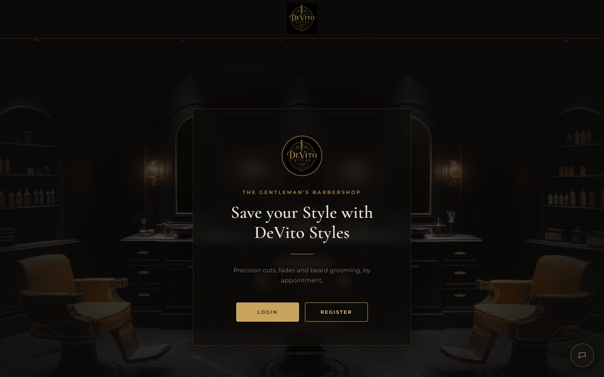 | 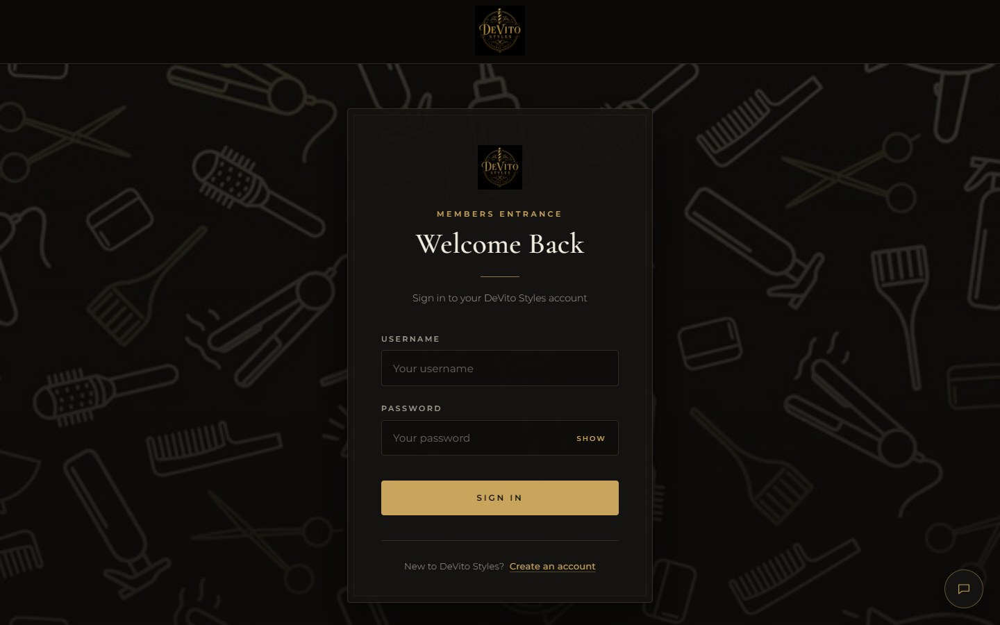 |
| **Register** | **Contact** |
| 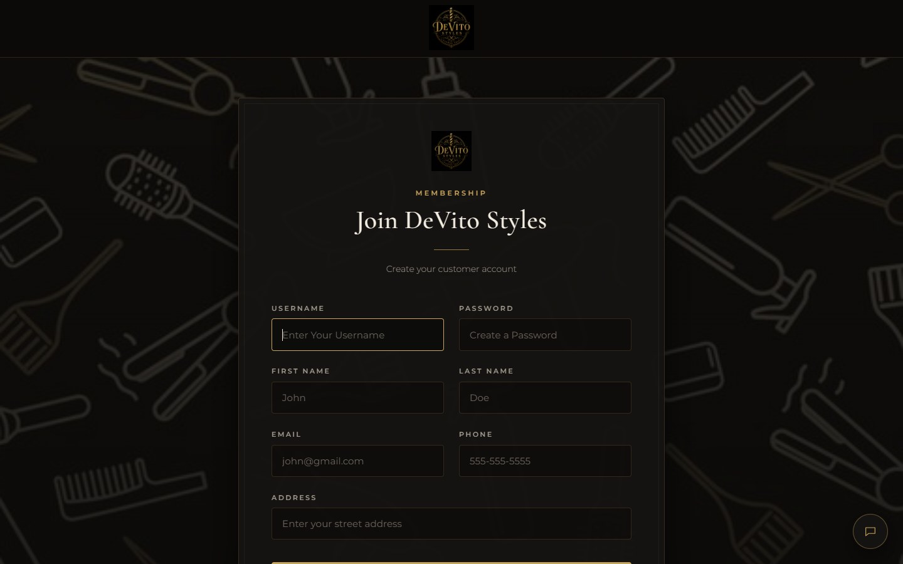 | 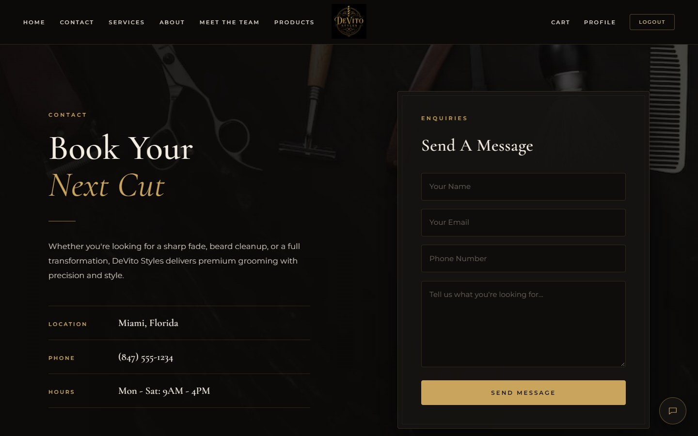 |
| **Services** | **Booking** |
|  | 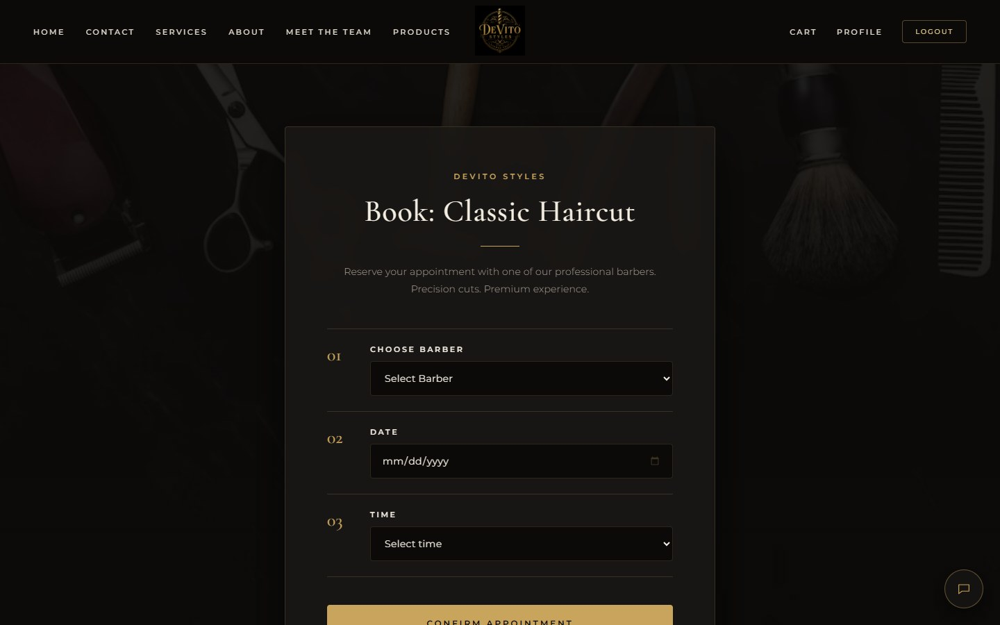 |
| **Meet the Team** | **Barber Profile** |
| 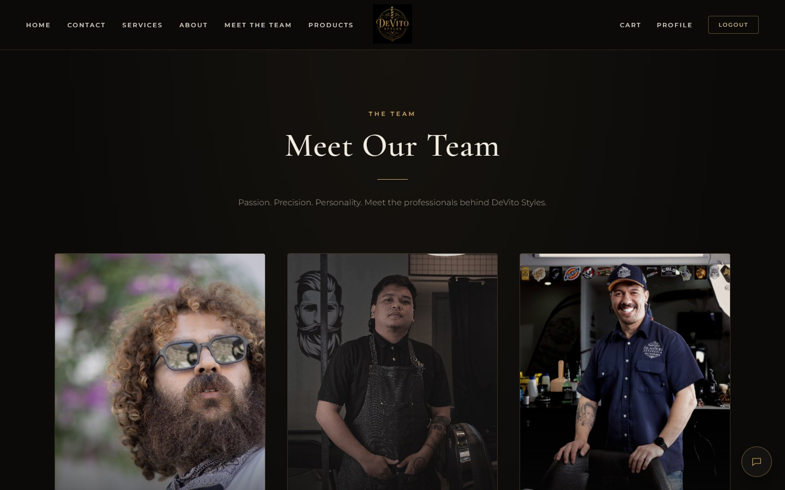 |  |
| **Shop** | **Product Details** |
| 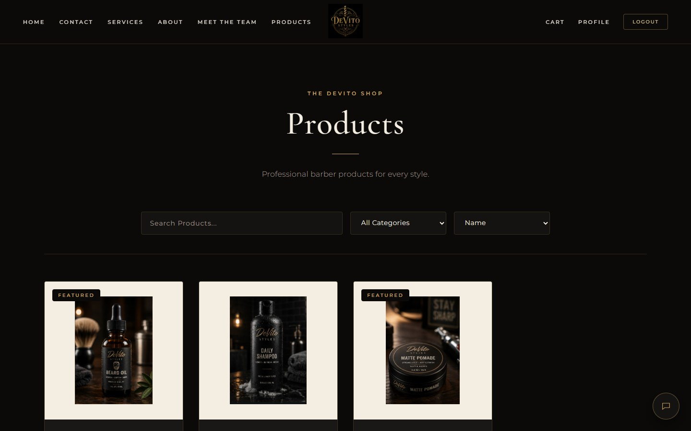 | 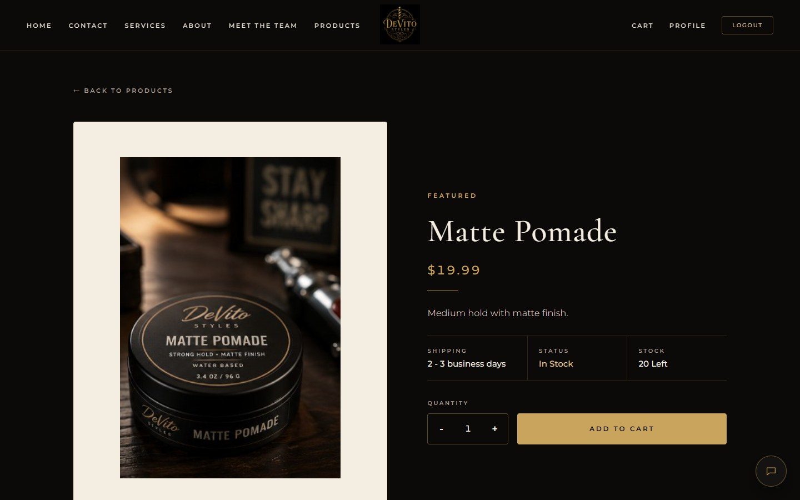 |
| **Cart** | **Profile** |
| 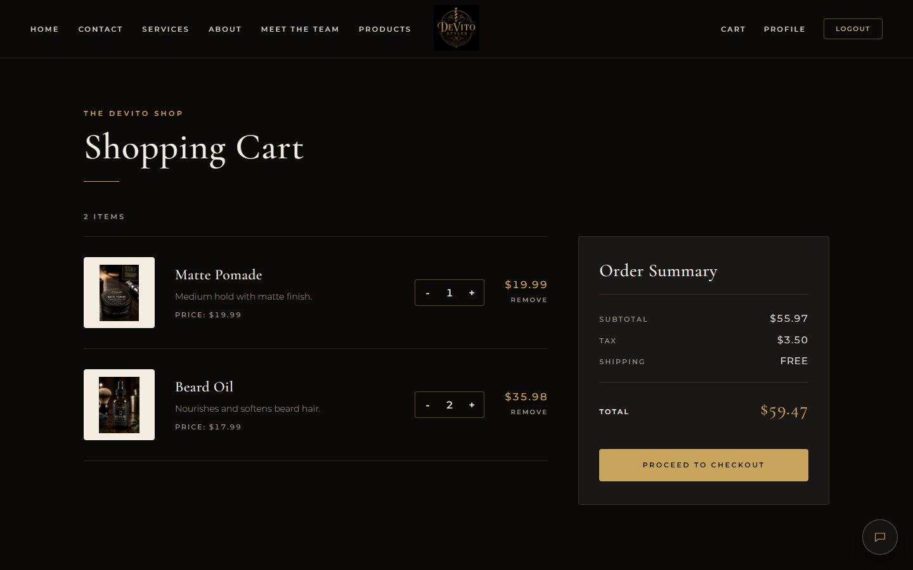 | 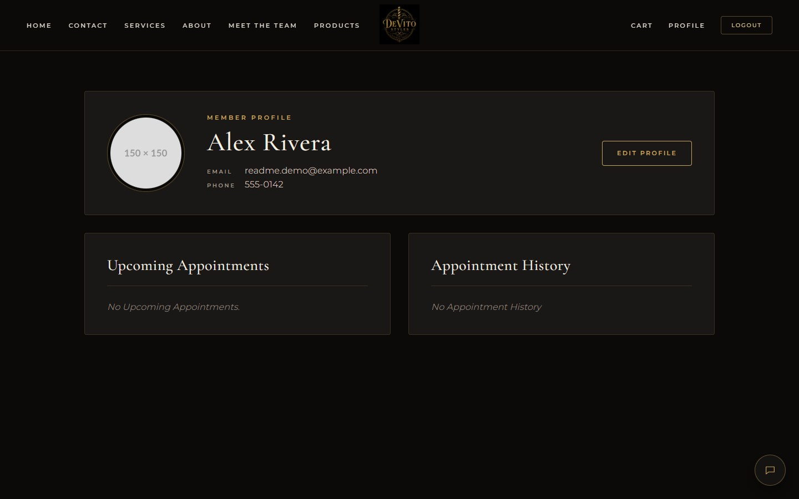 |
| **About** | **AI Concierge** |
| 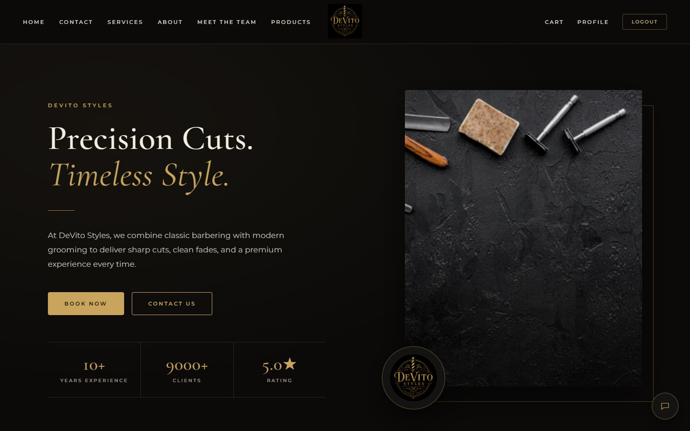 |  |

## Tech Stack

| Layer | Technologies |
| --- | --- |
| **Frontend** | React 19, React Router 7, Vite, JavaScript, CSS |
| **Backend** | Java 21, Spring Boot 3.2 (Web, Security, JDBC, Mail), JWT |
| **Database** | MySQL |
| **Payments** | Stripe Checkout and webhooks |
| **Integrations** | Cloudinary (images), Google Calendar API, SMTP email, Claude API for the chat assistant |
| **Testing** | JUnit 5, Mockito, Spring MockMvc |

## Getting Started

### Prerequisites

- Java 21 and Maven 3.9+
- Node.js 20+ and npm
- MySQL 8+
- A Stripe account (test mode is fine) and the [Stripe CLI](https://docs.stripe.com/stripe-cli) for local webhooks
- A Cloudinary account for image uploads
- An SMTP account for email (for example, a Gmail app password)
- *Optional:* a [Claude API key](https://console.anthropic.com/) for the chat assistant (without one, it replies that it's unavailable)
- *Optional:* a Google service account credentials file, for calendar events

### 1. Clone the repository

```bash
git clone https://github.com/Kush12747/DeVito-Styles.git
cd DeVito-Styles
```

### 2. Set up the database

Run the schema and seed scripts in MySQL:

```bash
mysql -u root -p < Server/DeVito-Styles/sql/production-schema.sql
mysql -u root -p < Server/DeVito-Styles/sql/initial-data.sql
```

> **Warning:** `production-schema.sql` drops and recreates the `devitostyles` database. Don't run it against data you want to keep.

### 3. Configure and run the backend

Set the environment variables listed below, then start the API on `http://localhost:8080`:

```bash
cd Server/DeVito-Styles
mvn spring-boot:run
```

For calendar events, place your Google service account file at `Server/DeVito-Styles/src/main/resources/google-credentials.json`. It's gitignored.

### 4. Run the frontend

```bash
cd Client
npm install
npm run dev
```

The app runs at `http://localhost:5173`. It reads the API location from `VITE_API_URL`, which `Client/.env.development` sets to `http://localhost:8080`.

### 5. Forward Stripe webhooks (for checkout)

```bash
stripe listen --forward-to localhost:8080/api/stripe/webhook
```

Use the signing secret it prints as `STRIPE_WEBHOOK_SECRET`. You can test checkout with the card `4242 4242 4242 4242`.

### Environment Variables

| Variable | Description |
| --- | --- |
| `DB_URL` | JDBC URL, e.g. `jdbc:mysql://localhost:3306/devitostyles` |
| `DB_USERNAME` / `DB_PASSWORD` | MySQL credentials |
| `MAIL_HOST` / `MAIL_PORT` | SMTP server, e.g. `smtp.gmail.com` / `587` |
| `MAIL_USERNAME` / `MAIL_PASSWORD` | SMTP credentials |
| `CLOUD_NAME` / `API_KEY` / `API_SECRET` | Cloudinary credentials |
| `STRIPE_SECRET_KEY` | Stripe secret key (`sk_test_...`) |
| `STRIPE_WEBHOOK_SECRET` | Stripe webhook signing secret (`whsec_...`) |
| `JWT_SECRET` | **Required.** Random string of at least 32 characters used to sign login tokens. Generate one with `node -e "console.log(require('crypto').randomBytes(32).toString('hex'))"` |
| `ANTHROPIC_API_KEY` | *Optional.* Claude API key for the chat assistant |
| `CLAUDE_MODEL` | *Optional.* Chat assistant model, default `claude-opus-5-5` (`claude-haiku-5-5` is cheapest) |

### Running the tests

```bash
cd Server/DeVito-Styles
mvn test -Dtest='learn.DeVitoStyles.domain.**.*Test,learn.DeVitoStyles.controller.**.*Test'
```

These unit tests need no database or credentials. The repository tests under `data/` run against a live MySQL test database built from `sql/test-schema.sql`.

## Deployment

Scripts for deploying the full stack to AWS live in [`deploy/`](deploy/). They use CloudFront, S3, ECS Fargate, RDS MySQL and Secrets Manager. See the [deployment guide](deploy/README.md) for setup, costs and teardown.

## API Reference

All endpoints are under `/api`. Except for login, register and the Stripe webhook, requests need an `Authorization: Bearer <token>` header from the login response.

<details>
<summary><strong>Users</strong></summary>

| Method | Endpoint | Description |
| --- | --- | --- |
| `POST` | `/api/user/register` | Register a new account |
| `POST` | `/api/user/login` | Log in and receive a JWT |
| `GET` | `/api/user` | Get all users |
| `GET` | `/api/user/{id}` | Get a user by ID |
| `PUT` | `/api/user/{id}` | Update a user |
| `POST` | `/api/user/{userId}/profile-picture` | Upload a profile picture (multipart) |

</details>

<details>
<summary><strong>Appointments</strong></summary>

| Method | Endpoint | Description |
| --- | --- | --- |
| `GET` | `/api/appointment` | Get all appointments |
| `GET` | `/api/appointment/{appointmentId}` | Get an appointment by ID |
| `GET` | `/api/appointment/user/{userId}` | Get a user's appointments |
| `GET` | `/api/appointment/barber/{barberId}?date=YYYY-MM-DD` | Get a barber's appointments on a date |
| `GET` | `/api/appointment/availability?barberId={id}&date=YYYY-MM-DD` | Get open time slots |
| `POST` | `/api/appointment` | Book an appointment |
| `PUT` | `/api/appointment/{appointmentId}` | Reschedule an appointment |
| `PUT` | `/api/appointment/cancel/{appointmentId}` | Cancel an appointment |

</details>

<details>
<summary><strong>Barbers & Services</strong></summary>

| Method | Endpoint | Description |
| --- | --- | --- |
| `GET` | `/api/barber` | Get all barbers |
| `GET` | `/api/barber/{id}` | Get a barber by ID |
| `POST` | `/api/barber` | Create a barber |
| `PUT` | `/api/barber/{id}` | Update a barber |
| `DELETE` | `/api/barber/{id}` | Delete a barber |
| `GET` | `/api/service` | Get all services |
| `GET` | `/api/service/{id}` | Get a service by ID |
| `POST` | `/api/service` | Create a service |
| `PUT` | `/api/service/{id}` | Update a service |
| `DELETE` | `/api/service/{id}` | Delete a service |

</details>

<details>
<summary><strong>Products & Categories</strong></summary>

| Method | Endpoint | Description |
| --- | --- | --- |
| `GET` | `/api/products?keyword=&categoryId=&featured=&sort=name` | Search, filter and sort products |
| `GET` | `/api/products/{productId}` | Get a product with details |
| `GET` | `/api/products/{productId}/related` | Get related products |
| `GET` | `/api/categories` | Get all categories |
| `GET` | `/api/categories/{categoryId}` | Get a category by ID |

</details>

<details>
<summary><strong>Cart & Checkout</strong></summary>

| Method | Endpoint | Description |
| --- | --- | --- |
| `GET` | `/api/cart/{userId}` | Get a user's cart |
| `POST` | `/api/cart/{userId}/items` | Add an item to the cart |
| `PUT` | `/api/cart/{userId}/items/{productId}` | Update an item's quantity |
| `DELETE` | `/api/cart/{userId}/items/{productId}` | Remove an item |
| `DELETE` | `/api/cart/{userId}` | Clear the cart |
| `POST` | `/api/checkout` | Create a pending order and return a Stripe Checkout URL |
| `POST` | `/api/stripe/webhook` | Stripe webhook receiver (signature-verified) |

</details>

<details>
<summary><strong>Reviews & Chat</strong></summary>

| Method | Endpoint | Description |
| --- | --- | --- |
| `GET` | `/api/review/{id}` | Get a review by ID |
| `POST` | `/api/review` | Create a review |
| `POST` | `/api/chat` | Send a message to the AI assistant |

</details>

## Project Structure

```
DeVito-Styles/
├── Client/                     # React frontend (Vite)
│   └── src/
│       ├── components/         # Pages and UI, grouped by feature
│       ├── Services/           # API client functions
│       ├── styles/             # Page stylesheets
│       └── index.css           # Design tokens and base styles
├── Server/DeVito-Styles/       # Spring Boot backend
│   ├── sql/                    # Schema, seed and test-schema scripts
│   └── src/
│       ├── main/java/learn/DeVitoStyles/
│       │   ├── controller/     # REST controllers
│       │   ├── domain/         # Services, validation, security, checkout
│       │   ├── data/           # JDBC repositories and row mappers
│       │   ├── models/         # Domain models
│       │   └── dto/            # Request and response objects
│       └── test/               # Unit and repository tests
├── deploy/                     # AWS deployment scripts and guide
└── images/                     # Screenshots, wireframes, schema diagrams
```

## Database Schema

The MySQL database has 16 tables, grouped below by area. The complete schema is in [`images/database-schema.mmd`](images/database-schema.mmd), a Mermaid ER file that mirrors [`production-schema.sql`](Server/DeVito-Styles/sql/production-schema.sql). Each diagram below is rendered from its own `images/database-schema-*.mmd` file.

**Accounts & Booking**: customers book appointments with a barber for a service and can leave one review per appointment.

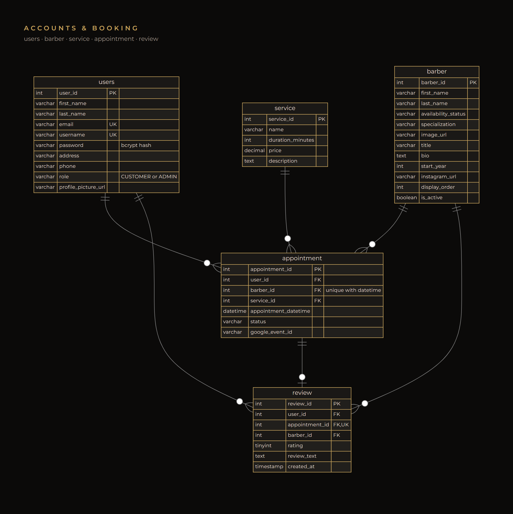

**Product Catalog**: each product belongs to a category and has optional specifications, benefits, ingredients and usage steps.

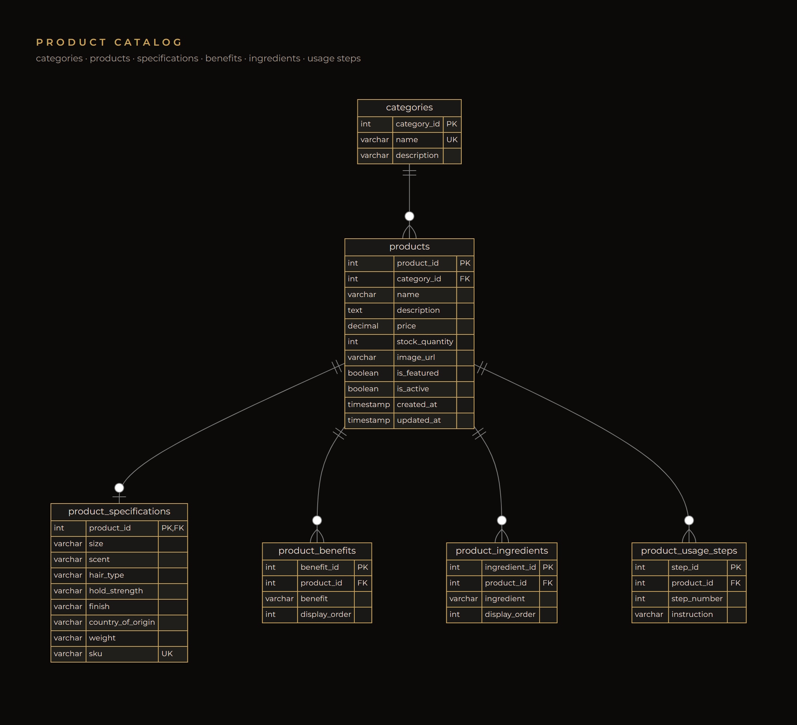

**Cart, Orders & Payments**: cart items become an order at checkout. Order items snapshot the product name and price, and payments track the Stripe payment status.

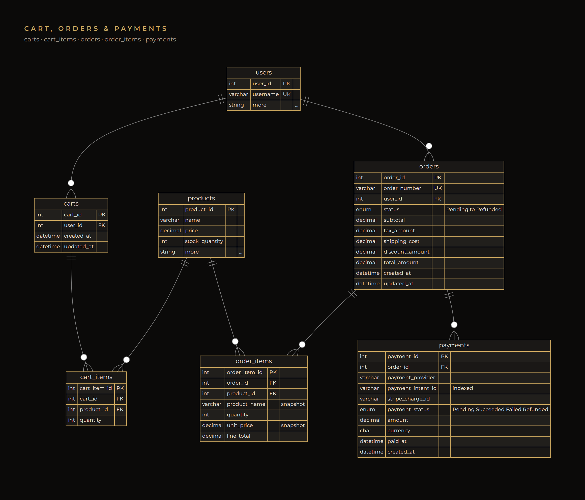

## Design

<details>
<summary><strong>Wireframes</strong></summary>

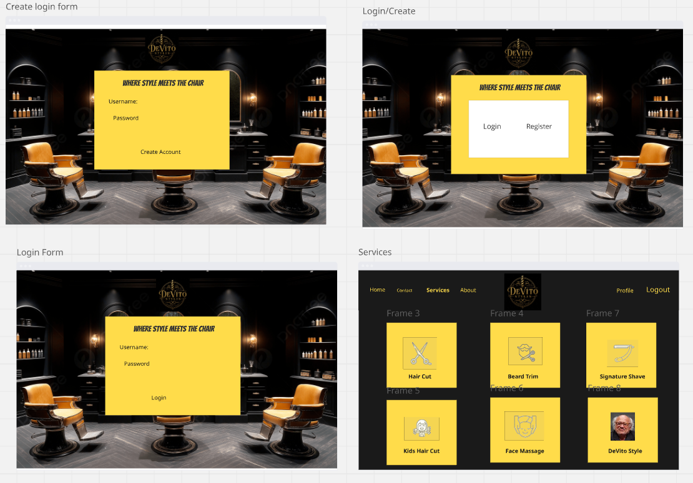
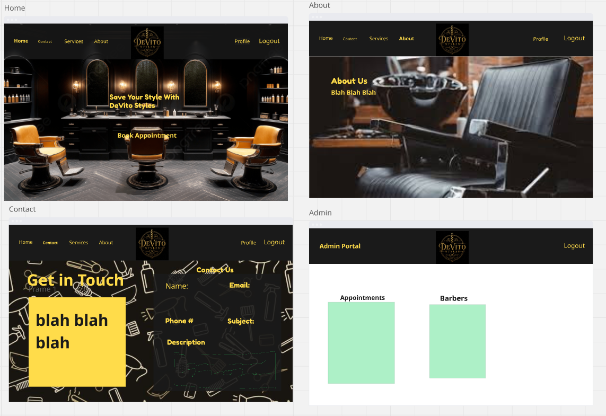
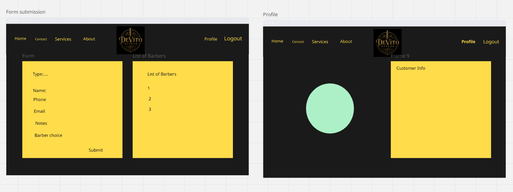

</details>

<details>
<summary><strong>User stories</strong></summary>

**Accounts**
- As a user, I want to register an account so that I can access the booking system.
- As a user, I want to log in so that I can access my dashboard.
- As a user, I want to log out of my account.

**Appointments**
- As a user, I want to view available appointment slots so that I can choose a time.
- As a user, I want to book an appointment so that I can schedule a haircut or other service.
- As a user, I want to edit an appointment so that I can change the date or time if needed.
- As a user, I want to cancel an appointment.
- As a user, I want to view my booked appointment details.

**Profile**
- As a user, I want to view my profile so that I can see my personal information.
- As a user, I want to edit my profile so that I can update my details.

**Shop**
- As a user, I want to browse and search grooming products.
- As a user, I want to add products to a cart and pay online.

**Admin**
- As an admin, I want to view all users and customers.
- As an admin, I want to view all appointments so that I can monitor bookings.
- As an admin, I want to view barbers and services so that I can manage availability.

**Notifications**
- As a user, I want an email when I book or cancel an appointment so that I have confirmation.

**Access control**
- As a system, I want to restrict admin pages to admins only.
- As a system, I want to restrict booking to logged-in users.

</details>

## Challenges

- Managing protected routes and auth state in React Router
- Designing relational tables for users, appointments, services, products, carts and orders
- Keeping the Stripe payment flow reliable when webhooks are retried, so inventory isn't reduced twice
- Handling asynchronous API calls and shared state across React components

## Future Enhancements

- Mobile app version
- Multi-language support
- Loyalty program for repeat customers
- Calendar view for barbers to manage their schedules
- Order history page for product purchases

## Author

**Kush Gandhi**

- GitHub: [@Kush12747](https://github.com/Kush12747)
- LinkedIn: [Kush Gandhi](https://www.linkedin.com/in/kush-gandhi32/)
- Email: kushgandhi2099@gmail.com
