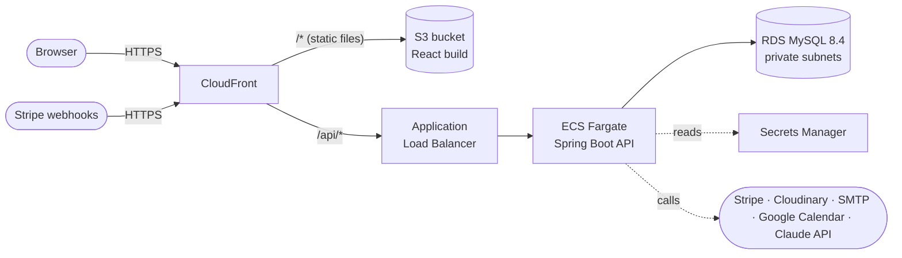

# Deploying DeVito Styles to AWS

These scripts deploy the full stack (React frontend, Spring Boot API and MySQL database) to AWS. Nothing runs until you run a script, and the first deploy asks for confirmation before it creates anything you'll be billed for.

> **Status:** prepared for future use. The template and scripts pass `cfn-lint` and ShellCheck, but they haven't been run against a real AWS account yet. Expect to fix small issues on the first real deploy.

## Contents

- [Architecture](#architecture)
- [What it costs](#what-it-costs)
- [Prerequisites](#prerequisites)
- [Configure](#configure)
- [First deploy](#first-deploy)
- [Set up the Stripe webhook](#set-up-the-stripe-webhook)
- [Day-to-day commands](#day-to-day-commands)
- [Saving money when idle](#saving-money-when-idle)
- [Tear down](#tear-down)
- [Known limitations](#known-limitations)
- [Troubleshooting](#troubleshooting)
- [Folder layout](#folder-layout)

## Architecture



- **One URL for everything.** CloudFront serves the React app and forwards `/api/*` to the backend, so the site and API share a domain. That means HTTPS works out of the box on the `*.cloudfront.net` address and there are no CORS issues.
- **The API is only reachable through CloudFront.** CloudFront adds a secret header, and the load balancer rejects any request without it.
- **The database is private.** RDS runs in subnets with no internet route; only the backend containers can reach it. RDS generates the master password and keeps it in Secrets Manager.
- **Secrets stay out of the code.** Mail, Cloudinary and Stripe keys go into Secrets Manager and are injected into the container at startup.
- **One CloudFormation stack** ([`cloudformation/devito-styles.yml`](cloudformation/devito-styles.yml)) holds everything except the container image repositories and the app secret, so teardown is a single command.

| Resource | Purpose |
| --- | --- |
| VPC with 2 public + 2 private subnets | Network across two availability zones |
| Application Load Balancer | Routes API traffic to the containers |
| ECS Fargate service | Runs the Spring Boot container (0.5 vCPU, 1 GB by default) |
| RDS MySQL 8.4 (`db.t4g.micro`) | Database, 7-day automated backups, encrypted storage |
| S3 bucket (private) | Hosts the built React app |
| CloudFront distribution | HTTPS, caching, routes `/api/*` to the backend |
| ECR repositories | Store the backend and database-setup images |
| Secrets Manager | App secrets and the database password |
| CloudWatch Logs | Backend logs, kept 14 days |

## What it costs

Rough monthly cost in `us-east-1` with the default sizes and light traffic. These are estimates; check the [AWS Pricing Calculator](https://calculator.aws/) for current prices.

| Item | Approx. per month |
| --- | --- |
| Fargate task (0.5 vCPU, 1 GB, always on) | $18 |
| Application Load Balancer | $17–20 |
| RDS `db.t4g.micro` + 20 GB storage | $14 |
| Public IPv4 addresses (load balancer + task) | $11 |
| Secrets Manager (2 secrets) | $1 |
| CloudFront, S3, ECR, CloudWatch | $1–3 |
| Claude API (chat assistant) | Pay per message, billed by Anthropic; typically well under 1¢ per chat |
| **Total** | **about $60–70** |

The AWS Free Tier can lower this for new accounts. See [Saving money when idle](#saving-money-when-idle) to cut costs when you're not using it, and always [tear down](#tear-down) when you're done.

## Prerequisites

**Tools** (run `./deploy/scripts/check-prereqs.sh` to verify):

| Tool | Notes |
| --- | --- |
| [AWS CLI v2](https://docs.aws.amazon.com/cli/latest/userguide/getting-started-install.html) | `aws --version` should show `aws-cli/2.x` |
| [Docker Desktop](https://www.docker.com/products/docker-desktop/) | Must be running while you deploy |
| Node.js 20+ and npm | Builds the frontend; also used by the scripts |
| Git and Bash | On Windows, run the scripts from **Git Bash** |

You don't need Maven or Java installed; the backend is built inside Docker.

**AWS account and credentials:**

1. Create an AWS account and an IAM user (or IAM Identity Center user) for deploying. For a personal project, the simplest option is the `AdministratorAccess` policy. The scripts create IAM roles, VPCs, RDS, ECS, ECR, S3, CloudFront and Secrets Manager resources.
2. Configure the CLI:
   ```bash
   aws configure            # access key, secret key, region (e.g. us-east-1)
   # or, with IAM Identity Center:
   aws configure sso && aws sso login
   ```
3. Check it works: `aws sts get-caller-identity`

**Project files:**

- `Server/DeVito-Styles/src/main/resources/google-credentials.json` must exist (it's gitignored). The backend loads it at startup and won't start without it, so it's built into the image.

## Configure

```bash
cp deploy/config.example.env deploy/config.env
```

Open `deploy/config.env` and fill in:

| Setting | What to put |
| --- | --- |
| `AWS_REGION` | Region to deploy to, e.g. `us-east-1` |
| `AWS_PROFILE` | CLI profile name, or blank for your default credentials |
| `PROJECT_NAME`, `STACK_NAME` | Leave as `devito-styles` unless you want several copies |
| `MAIL_*` | SMTP settings. For Gmail, use an [app password](https://support.google.com/accounts/answer/185833) |
| `CLOUD_NAME`, `API_KEY`, `API_SECRET` | Cloudinary credentials |
| `STRIPE_SECRET_KEY` | `sk_test_...` until you're ready for real payments |
| `STRIPE_WEBHOOK_SECRET` | Leave blank for now; you'll set it after the first deploy |
| `JWT_SECRET` | Leave blank: setup generates a random key, stores it in Secrets Manager and reuses it on every redeploy |
| `ANTHROPIC_API_KEY` | Claude API key for the chat assistant, from the [Claude Console](https://console.anthropic.com/). Blank deploys without it; the assistant then says it's unavailable |
| `CLAUDE_MODEL` | Model for the chat assistant. Defaults to `claude-opus-5-5`; `claude-haiku-5-5` is the cheapest |

`config.env` is gitignored. The scripts also write generated values (the image tag, secret ARN and origin header value) to `deploy/.state.env`, which is gitignored too.

## First deploy

From the repository root, in Git Bash (Windows) or a terminal (macOS/Linux):

```bash
./deploy/scripts/deploy-all.sh
```

It takes about 25–35 minutes, mostly waiting for RDS and CloudFront. It asks once before creating billable resources, then:

1. Checks your tools, config and AWS credentials
2. Creates the ECR repositories and stores your secrets in Secrets Manager
3. Builds the backend image and pushes it to ECR
4. Creates the CloudFormation stack with the backend stopped
5. Loads `production-schema.sql` and `initial-data.sql` into the new database
6. Starts the backend
7. Builds the frontend against the live URL and uploads it

At the end it prints the site URL, e.g. `https://d1234abcd.cloudfront.net`.

<details>
<summary><strong>Running the steps one at a time</strong></summary>

```bash
./deploy/scripts/check-prereqs.sh
./deploy/scripts/1-setup.sh                         # ECR repos + secrets
./deploy/scripts/2-build-backend.sh                 # build + push image
./deploy/scripts/3-deploy-infra.sh --desired-count 0   # create stack, backend stopped
./deploy/scripts/4-init-database.sh --confirm-drop  # load schema + seed data
./deploy/scripts/3-deploy-infra.sh                  # start the backend
./deploy/scripts/5-deploy-frontend.sh               # build + upload React app
```

</details>

## Set up the Stripe webhook

Checkout works without this, but orders only get marked paid (and stock reduced) when Stripe can call the webhook.

1. Get the webhook URL: `./deploy/scripts/status.sh` (it's `https://<your-site>/api/stripe/webhook`).
2. In the Stripe dashboard (test mode), go to **Developers → Webhooks → Add endpoint**, paste the URL, and select these events:
   - `checkout.session.completed`
   - `checkout.session.async_payment_succeeded`
   - `checkout.session.async_payment_failed`
   - `payment_intent.succeeded`
   - `payment_intent.payment_failed`
   - `charge.refunded`
   - `refund.updated`
3. Copy the endpoint's signing secret (`whsec_...`) into `config.env` as `STRIPE_WEBHOOK_SECRET`.
4. Push it to AWS and restart the backend:
   ```bash
   ./deploy/scripts/update.sh secrets
   ```

## Day-to-day commands

| Task | Command |
| --- | --- |
| Deploy backend code changes | `./deploy/scripts/update.sh backend` |
| Deploy frontend changes | `./deploy/scripts/update.sh frontend` |
| Deploy both | `./deploy/scripts/update.sh all` |
| Change a secret (edit `config.env` first) | `./deploy/scripts/update.sh secrets` |
| See URL, health and recent events | `./deploy/scripts/status.sh` |
| View backend logs | `./deploy/scripts/logs.sh` (add `--follow` to stream, `--since 2h` for older) |
| Reset the database to seed data (**deletes all data**) | `./deploy/scripts/deploy-all.sh --reset-db` |

Backend deploys are rolling: the new container must pass health checks before the old one stops. If it doesn't, ECS rolls back automatically.

Add `--yes` to `deploy-all.sh` or `3-deploy-infra.sh` to skip the confirmation prompt (for example, in CI).

## Saving money when idle

- **Stop the backend containers** (keeps everything else):
  ```bash
  ./deploy/scripts/3-deploy-infra.sh --desired-count 0
  ```
  Start them again with `./deploy/scripts/3-deploy-infra.sh`.
- **Stop the database** for up to 7 days (AWS restarts it automatically after that):
  ```bash
  aws rds stop-db-instance --db-instance-identifier devito-styles-db
  aws rds start-db-instance --db-instance-identifier devito-styles-db
  ```
- The load balancer and public IPs still cost about $25/month while stopped. If you won't use the site for a while, tear it down instead.

## Tear down

```bash
./deploy/scripts/destroy.sh          # delete the stack (keeps images and the app secret)
./deploy/scripts/destroy.sh --all    # also delete ECR repositories and the app secret
```

You'll be asked to type the stack name to confirm. Deleting takes 10–20 minutes because of CloudFront.

RDS keeps a **final snapshot** of the database when the stack is deleted, so your data isn't lost by accident. Snapshots cost about $0.095/GB-month; the script prints the commands to list and delete them.

## Known limitations

These are things in the app (not the scripts) to be aware of before going live:

- **Google credentials are baked into the image.** The ECR repository is private, but anyone with access to it can read the file. Moving it to Secrets Manager would need a small code change to load it from a file path.
- **No health endpoint.** The load balancer treats any HTTP response from `/` as healthy. Adding Spring Boot Actuator and pointing the health check at `/actuator/health` would be more precise.
- **Default CloudFront domain.** For a custom domain like `devitostyles.com`, you'd add an ACM certificate (in `us-east-1`) and an alias on the distribution.
- **The app connects as the RDS master user.** Fine for a demo; for production, create a dedicated database user with fewer privileges.

## Troubleshooting

| Symptom | Where to look |
| --- | --- |
| `deploy-all.sh` fails during stack creation | CloudFormation console → stack → **Events** shows the failing resource and why |
| Site loads but API calls fail (502/503) | `./deploy/scripts/status.sh` and `./deploy/scripts/logs.sh`. Usually a missing secret or a startup error |
| Backend keeps restarting | `./deploy/scripts/logs.sh --since 30m`. Look for `APPLICATION FAILED TO START` |
| Old frontend still showing | CloudFront invalidations take 1–2 minutes; hard-refresh the browser |
| `4-init-database.sh` fails | It prints the task logs; check the SQL error |
| Commands fail with odd `C:/Program Files/Git/...` paths | Run the scripts from Git Bash; `lib.sh` disables Git Bash path conversion |
| `docker: Cannot connect to the Docker daemon` | Start Docker Desktop |
| Stack stuck in `ROLLBACK_COMPLETE` | Delete it (`./deploy/scripts/destroy.sh`) and deploy again |

## Folder layout

```
deploy/
├── README.md                     # This guide
├── config.example.env            # Copy to config.env and fill in
├── cloudformation/
│   └── devito-styles.yml         # All AWS infrastructure
├── docker/
│   ├── backend.Dockerfile        # Builds and runs the Spring Boot API
│   ├── db-init.Dockerfile        # One-off image that loads the SQL scripts
│   └── db-init.sh
└── scripts/
    ├── check-prereqs.sh          # Verify tools, config and credentials
    ├── 1-setup.sh                # ECR repositories + Secrets Manager
    ├── 2-build-backend.sh        # Build and push the backend image
    ├── 3-deploy-infra.sh         # Create/update the CloudFormation stack
    ├── 4-init-database.sh        # Load schema + seed data (destructive)
    ├── 5-deploy-frontend.sh      # Build and upload the React app
    ├── deploy-all.sh             # Steps 1-5 in order
    ├── update.sh                 # Redeploy backend, frontend or secrets
    ├── status.sh                 # URL, health, recent events
    ├── logs.sh                   # Backend logs
    ├── destroy.sh                # Tear everything down
    ├── lib.sh                    # Shared helpers
    └── helpers/                  # Small Node scripts that build JSON safely
```
